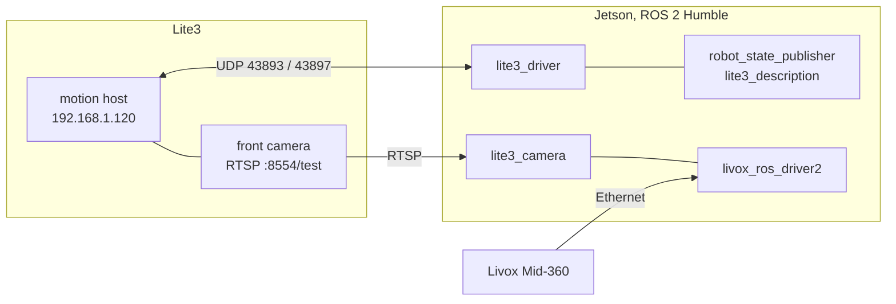

<div align="center">

# lite3_ros2

**ROS 2 robot package for the Deep Robotics Jueying Lite3: the motion host's UDP protocol as a
driver, the URDF with every sensor frame, the robot's own RTSP camera, and one launch for the
Livox Mid-360 and the camera.**

[](https://github.com/DarmawanRobotics/lite3_ros2/actions/workflows/ci.yml)
[](https://docs.ros.org/en/humble/)
[](https://releases.ubuntu.com/22.04/)


[](LICENSE)

[Packages](#packages) · [Network](#network) · [Quick start](#quick-start) ·
[Verify on the real robot](#verify-on-the-real-robot) · [Safety](#safety) · [Develop](#develop)

</div>

---

The Lite3's motion host takes commands and reports its state over UDP (Deep Robotics *UDP
Commands* V1.1.0). This repository turns that into ROS 2 Humble topics and services on an added
computer (a Jetson Orin NX with a Livox Mid-360), and follows the robot package contract of
[Molly](https://github.com/DarmawanRobotics/Molly) (`src/xtras/README.md` there), where it is the
`ROBOT_BRINGUP=lite3_bringup` of the tour guide.



## Packages

| Package | |
|---|---|
| [`lite3_driver`](lite3_driver/README.md) | the UDP driver: `cmd_vel` → speed commands in navigation mode; state → `odom`, `imu`, `battery`, `joint_states`, `ultrasound/*`, `state`, `diagnostics`; every robot command as a `std_srvs/Trigger` service; gestures |
| [`lite3_interfaces`](lite3_interfaces/README.md) | `RobotState`: basic state, gait, motion, battery, ultrasound, link, gesture |
| [`lite3_description`](lite3_description/README.md) | URDF: legs from the document, Mid-360, D435i or front camera, IMU and ultrasound frames |
| [`lite3_camera`](lite3_camera/README.md) | the robot's wide-angle front camera over RTSP: Jetson hardware decoding, reconnects, rectification |
| [`lite3_bringup`](lite3_bringup/README.md) | one launch for all of it, and [`scripts/lite3_setup.sh`](lite3_bringup/scripts/lite3_setup.sh) |

**Services** of the driver, under the namespace (`/robot/` by default):

| | |
|---|---|
| posture | `stand_up`, `sit_down` (state aware), `emergency_stop` (soft e-stop), `reset_zero` |
| modes | `navigation_mode`, `manual_mode`, `move_mode`, `pose_mode` |
| gaits | `gait_slow`, `gait_medium`, `gait_fast`, `gait_crawl`, `gait_general`, `gait_grip`, `gait_high_step` |
| gestures (block until done) | `hello`, `nod`, `bow`, `look_left`, `look_right` |
| other | `stop_action`, `keep_stepping_on` / `_off`, `speaker_on` / `_off`, `save_data` |

## Network

From the Deep Robotics documents (*UDP Commands* V1.1.0, *SDK Deploy* V1.0.0):

| | |
|---|---|
| motion host | `192.168.1.120` (some robots `192.168.2.1`), commands to UDP **43893** |
| perception host | `192.168.1.103` (Deep Robotics' own computer) |
| state reports | sent to every `ips` / `ports` entry of `~/jy_exe/conf/network.toml` on the motion host, port **43897** by default |
| front camera | `rtsp://192.168.1.120:8554/test` |
| heartbeat | `0x21040001`, at least 2 Hz (the driver sends 5 Hz) |
| velocity | speed commands `0x0140` / `0x0145` / `0x0141` (one double each), obeyed in **navigation mode** only |

**The Jetson must be in `network.toml`**, otherwise the motion host takes commands but sends no
state, and the driver reports `no state from 192.168.1.120`. `lite3_setup.sh network` prints the
change for this computer (and `--apply` makes it over ssh with a backup); restart the robot
afterwards.

Give the Jetson a free static address on the robot's network (e.g. `192.168.1.110`) and the
Mid-360 its own (`192.168.1.1XX`, from its serial number), then set `LIVOX_LIDAR_IP` and
`LIVOX_HOST_IP` (or `lidar_ip:=` / `host_ip:=`).

## Quick start

Ubuntu 22.04, ROS 2 Humble (JetPack 6 on the Jetson). Connect the Jetson to the robot's network
first (see [Network](#network)).

```bash
# 1. Sources and dependencies
mkdir -p ~/ros2_ws/src && cd ~/ros2_ws/src
git clone https://github.com/DarmawanRobotics/lite3_ros2.git
git clone -b humble https://github.com/JasonY85/livox_ros_driver2.git   # optional, needs Livox-SDK2
lite3_ros2/lite3_bringup/scripts/lite3_setup.sh install

# 2. network.toml: let the motion host send its state to this computer, then restart the robot
lite3_ros2/lite3_bringup/scripts/lite3_setup.sh network           # prints the change
lite3_ros2/lite3_bringup/scripts/lite3_setup.sh network --apply   # makes it over ssh, with a backup

# 3. Build
cd ~/ros2_ws
rosdep install --from-paths src --ignore-src -y
colcon build && source install/setup.bash

# 4. Launch
ros2 launch lite3_bringup bringup.launch.py

# 5. In a second terminal: check state reports, GStreamer and OpenCV
~/ros2_ws/src/lite3_ros2/lite3_bringup/scripts/lite3_setup.sh check
ros2 topic echo --once /robot/state
```

Then work through [Verify on the real robot](#verify-on-the-real-robot), including the `cmd_vel`
sign conventions (steps 5 and 6), before any autonomy drives the robot.

Inside Molly the repository is the submodule `src/xtras/robots/lite3_ros2`, with
`ROBOT_BRINGUP=lite3_bringup`, `ROBOT_SETUP=src/xtras/robots/lite3_ros2/lite3_bringup/scripts/lite3_setup.sh`
and `ROBOT_IP=192.168.1.120` in `/etc/molly/molly.env`.

## Verify on the real robot

On a new robot, in an open area with someone at the remote:

1. **Jetson in `network.toml`:** `ros2 topic hz /robot/odom` shows ~50 Hz and
   `ros2 topic echo /robot/state` says `connected: true` and the real basic state. If not:
   `lite3_setup.sh network`, then restart the robot.
2. **State layout:** `state.layout` is `natural`, `pack4` or `pack1`. `prefix` means an unknown
   report length (only attitude, odometry and velocities are decoded): report it.
3. **Stand:** `ros2 service call /robot/stand_up std_srvs/srv/Trigger`.
4. **Navigation mode:** speed commands are obeyed in navigation mode only. With
   `auto_navigation_mode: true` (default) the driver switches on its own and `state.control_mode`
   reads `navigation`; otherwise call `/robot/navigation_mode`.
5. **Forward:** `ros2 topic pub -r 20 /robot/cmd_vel geometry_msgs/msg/Twist "{linear: {x: 0.1}}"`
   walks forward. Stop the publisher: the robot stops within 0.5 s.
6. **Turn and strafe (REP-103):** `{angular: {z: 0.3}}` must turn the robot **left**
   (counter-clockwise seen from above), else set `invert_wz: true`; `{linear: {y: 0.1}}` must move
   it **left**, else `invert_vy: true`. Set both in your copy of
   [driver_params.yaml](lite3_driver/config/driver_params.yaml) (`driver_params:=`).
7. **Frames:** `ros2 run tf2_ros tf2_echo base_link livox_imu_frame`, and measure the front
   camera and ultrasound positions: the URDF has estimates for them
   ([lite3_description](lite3_description/README.md#frames-relative-to-base_link-metres)).
8. **Camera:** `ros2 topic hz /camera/camera/color/image_raw`, then calibrate it
   ([lite3_camera](lite3_camera/README.md#calibration)) and set `calibration_file` before using
   AprilTags.
9. **Gestures:** `nod`, `bow`, `look_left`, `look_right` and `hello` with nobody close to the robot.

## Safety

- The driver stops on its own: no `cmd_vel` for 0.5 s gives zeros, then silence. Only Molly's
  control mux should publish on `/robot/cmd_vel`.
- `emergency_stop` sends the motion host's soft emergency stop; the remote and the robot's own
  stop button always work too.
- Gestures only run while the robot stands still; any motion command stops them. `hello` makes
  a standing robot sit down first (the action needs sitting) and stand up again after.
- `save_data` makes the robot save its log, soft-stop and **quit its motion program**.
- With `auto_navigation_mode` the driver switches the robot to navigation mode when motion
  starts: the remote then drives only after switching back to manual.

## Develop

```bash
colcon build && colcon test --executor sequential && colcon test-result --verbose
```

The codec is tested against the document's own worked example (appendix 2.1) and the three
possible layouts of the state struct; the driver against a fake motion host on the loopback
interface; gestures against a simulated motion host; the URDF against the document's numbers;
the camera's pipelines, calibration and frame publishing without a camera. CI runs the same in a
`ros:humble` container, plus shellcheck.

Joint axes and leg inertials come from Deep Robotics' Lite3 URDF
([DeepRoboticsLab/Lite3_rl_training](https://github.com/DeepRoboticsLab/Lite3_rl_training),
BSD-3-Clause). lite3_ros2 is released under the [Apache License 2.0](LICENSE).
